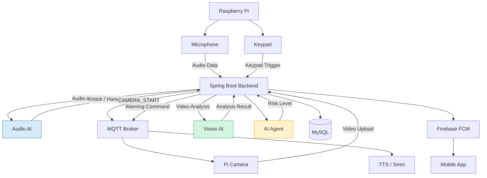
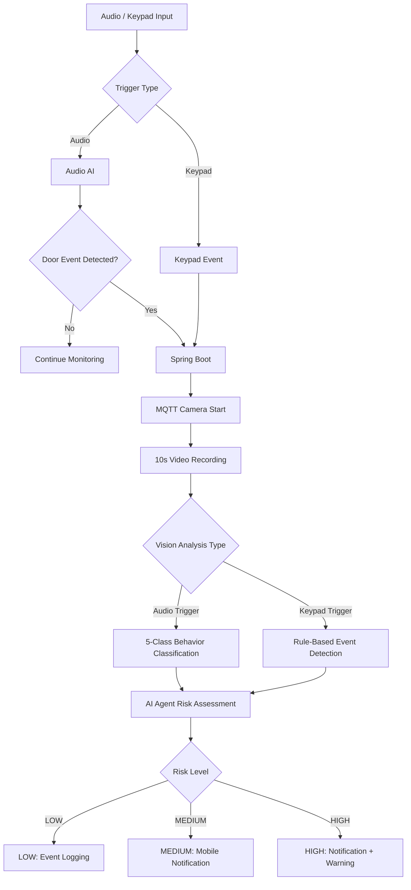
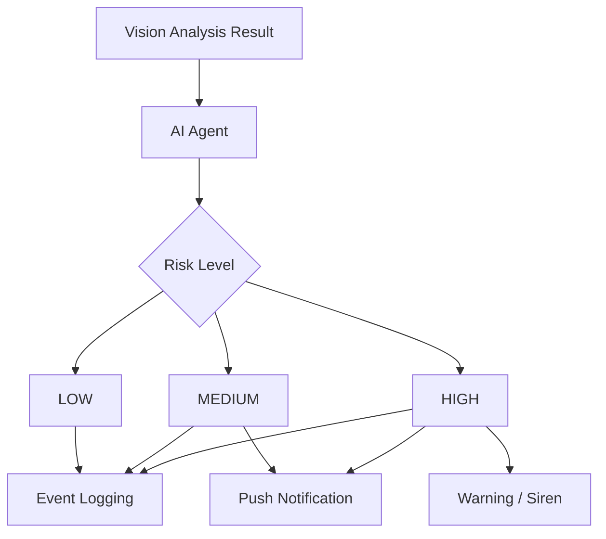
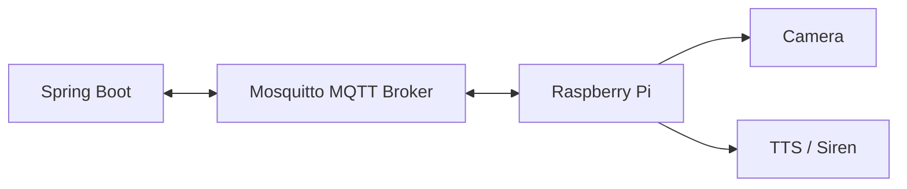

<div align="center">

# 🛡️ OmniGuardy

### Vision · Audio 멀티모달 기반 AIoT 스마트 현관 보안 시스템

**Audio & Keypad Trigger-Based Smart Door Security System**

현관 주변의 이상 징후를 감지하고,  
AI 기반 상황 분석과 위험도 판단을 통해 단계별 대응을 수행하는 스마트 보안 서비스

<br/>


<br/>


<br/>

**2026 Capstone Design | Team 3 Guardians**

</div>

---

## 📌 1. Project Overview

### 프로젝트 소개

**OmniGuardy**는 Vision과 Audio 데이터를 활용하여 현관 주변의 이상 상황을 감지하고, AI Agent가 위험도를 판단하여 단계별 대응을 수행하는 **AIoT 기반 스마트 현관 보안 시스템**입니다.

기존 현관 보안 시스템은 CCTV 영상 저장 및 사후 확인 중심으로 운영되어, 위험 상황을 실시간으로 판단하고 즉각적으로 대응하는 데 한계가 있습니다.

OmniGuardy는 이러한 문제를 해결하기 위해 **이벤트 기반 영상 분석과 AI Agent 기반 위험 대응 시스템**을 구현합니다.

### 핵심 목표

- Audio AI를 활용한 현관문 이벤트 감지
- Audio 및 Keypad 기반 이중 트리거
- 이벤트 발생 시 카메라 촬영 자동 실행
- Vision AI 기반 현관 앞 행동 분석
- AI Agent 기반 위험도 판단
- 위험도별 차등 대응 및 사용자 알림
- Raspberry Pi 기반 IoT 기기 연동

### Core Concept

> **Audio detects events. Vision analyzes behavior. AI Agent determines risk.**

---

## 🏗️ 2. System Architecture

OmniGuardy는 **Audio AI와 Keypad의 이중 트리거 구조**를 사용합니다.

Audio AI는 Knock 및 Handle Turn 이벤트를 감지하고, Keypad는 사용자 입력을 통해 카메라 촬영을 요청합니다.

트리거가 발생하면 Spring Boot 서버가 카메라 상태와 중복 요청을 관리하고, Raspberry Pi를 통해 영상을 촬영합니다.

촬영된 영상은 Vision AI 서버에서 분석되며, AI Agent가 분석 결과를 바탕으로 위험도를 판단합니다.



### Detection Workflow



---

## ✨ 3. Key Features

| 기능 | 설명 |
|------|------|
| 🔊 Audio Event Detection | Knock 및 Handle Turn 이벤트 감지 |
| ⌨️ Dual Trigger | Audio / Keypad 이중 트리거 |
| 📷 Camera Control | MQTT 기반 카메라 촬영 제어 |
| 🎥 Vision Analysis | 현관 앞 행동 5-Class 분류 |
| 🖐️ Emergency Detection | Silent Signal 및 후방 접근 의심 감지 |
| 🤖 AI Agent | 분석 결과 기반 위험도 판단 |
| 🚨 Risk Response | LOW / MEDIUM / HIGH 단계별 대응 |
| 🔔 Push Notification | Firebase FCM 기반 모바일 알림 |
| 🗣️ TTS Warning | 음성 경고 및 사이렌 제어 |
| 🔐 Authentication | JWT 기반 사용자 인증 |

---


## 🤖 4. AI Agent & Risk Response

AI Agent는 Vision AI의 분석 결과와 감지된 이벤트를 바탕으로 위험도를 판단합니다.

### Risk Levels

| Risk Level | Example | Response |
|------------|---------|----------|
| LOW | 반복 노크 | 이벤트 기록 |
| MEDIUM | 문손잡이 조작 | 모바일 알림 |
| HIGH | Silent Signal | 모바일 알림 및 경고 출력 |

위 표는 발표자료의 주요 시연 시나리오 기준입니다.

### Risk Response Flow



---

## 🛠️ 5. Tech Stack

### Backend

| Category | Technology |
|----------|------------|
| Language | Java 21 |
| Framework | Spring Boot 4.0.6 |
| Security | Spring Security, JWT |
| Database | MySQL 8.0 |
| ORM | Spring Data JPA |
| Build Tool | Gradle |
| AI Agent | LangChain4j, OpenAI |
| Messaging | MQTT, Eclipse Paho |
| Notification | Firebase Cloud Messaging |
| TTS | Google Cloud Text-to-Speech |

### AI

| Category | Technology |
|----------|------------|
| Language | Python |
| Framework | FastAPI |
| Audio Model | CNN |
| Audio Features | Mel Spectrogram |
| Vision Detection | YOLOv8n |
| Vision Tracking | BoT-SORT |
| Pose Estimation | MediaPipe |
| Behavior Classification | Temporal Fusion GRU |
| Model Inference | ONNX Runtime |

### IoT & Infrastructure

| Category | Technology |
|----------|------------|
| Edge Device | Raspberry Pi |
| Camera | Raspberry Pi Camera |
| Audio Input | Microphone |
| Door Lock UI | Touch Keypad |
| Messaging | Eclipse Mosquitto |
| Container | Docker, Docker Compose |

---

## 📂 6. Project Structure

본 저장소는 Spring Boot 백엔드 프로젝트입니다.

```text
omniguardy-backend/
│
├── src/
│   ├── main/
│   │   ├── java/com/omniguardy/backend/
│   │   │   │
│   │   │   ├── domain/
│   │   │   │   ├── ai/
│   │   │   │   ├── auth/
│   │   │   │   ├── detection/
│   │   │   │   ├── notification/
│   │   │   │   ├── securityevent/
│   │   │   │   ├── sound/
│   │   │   │   ├── tts/
│   │   │   │   └── user/
│   │   │   │
│   │   │   └── BackendApplication.java
│   │   │
│   │   └── resources/
│   │       ├── application.yml
│   │       └── application-dev.yml
│   │
│   └── test/
│
├── gradle/
├── mosquitto/
├── .github/
│   └── workflows/
│
├── build.gradle
├── settings.gradle
├── docker-compose.dev.yml
├── gradlew
├── gradlew.bat
└── README.md
```

### Layered Architecture

| Layer | Responsibility |
|-------|----------------|
| Presentation | REST API 요청 및 응답 처리 |
| Application | 비즈니스 유스케이스 실행 |
| Domain | 도메인 모델 및 비즈니스 규칙 |
| Infrastructure | 데이터베이스 및 외부 시스템 연동 |

---

## 🚀 7. Getting Started

### Requirements

- Java 21
- Docker
- Docker Compose
- Git
- MySQL 8.0

### 1. Clone Repository

```bash
git clone https://github.com/2026-team3/omniguardy-backend.git

cd omniguardy-backend
```

### 2. Start Docker Containers

개발 환경에서 MySQL과 MQTT Broker를 실행합니다.

```bash
docker compose -f docker-compose.dev.yml up -d
```

컨테이너 상태 확인:

```bash
docker ps
```

컨테이너 종료:

```bash
docker compose -f docker-compose.dev.yml down
```

### 3. Environment Configuration

주요 설정 파일:

```text
src/main/resources/application.yml
src/main/resources/application-dev.yml
```

환경에 맞게 데이터베이스 및 외부 서비스 연결 정보를 설정합니다.

| Configuration | Description |
|---------------|-------------|
| Database URL | MySQL 연결 주소 |
| Database Username | 데이터베이스 사용자 |
| Database Password | 데이터베이스 비밀번호 |
| JWT Secret | JWT 서명 키 |
| MQTT Broker URL | MQTT 서버 주소 |
| FastAPI Audio URL | Audio AI 서버 주소 |
| FastAPI Vision URL | Vision AI 서버 주소 |
| OPENAI_API_KEY | OpenAI API 인증 키 |

> API Key, JWT Secret 및 데이터베이스 비밀번호는 환경 변수나 Secret 관리 시스템을 사용하여 안전하게 관리해야 합니다.

### 4. Run Spring Boot

Windows:

```bash
.\gradlew.bat bootRun
```

macOS / Linux:

```bash
./gradlew bootRun
```

기본 서버 주소:

```text
http://localhost:8080
```


## 📬 8. MQTT Communication

OmniGuardy는 Raspberry Pi와 Spring Boot 서버 간 통신에 MQTT를 사용합니다.

### MQTT Architecture



### MQTT Topics

| Topic | Description |
|-------|-------------|
| `door/camera` | 카메라 촬영 명령 |
| `door/tts` | 음성 안내 관련 메시지 |

### Camera Control

```text
1. Audio 또는 Keypad 이벤트 발생
2. Spring Boot 서버에서 트리거 수신
3. 카메라 상태 및 중복 요청 확인
4. MQTT CAMERA_START 명령 전송
5. Raspberry Pi에서 약 10초간 영상 촬영
6. MP4 파일을 Spring Boot 서버로 업로드
7. Vision AI 분석 요청
```

---


## 🧪 9. Build & Test

### Build

Windows:

```bash
.\gradlew.bat build
```

macOS / Linux:

```bash
./gradlew build
```

### Test

Windows:

```bash
.\gradlew.bat test
```

macOS / Linux:

```bash
./gradlew test
```

---


<div align="center">

### 🛡️ OmniGuardy

**Vision · Audio Multimodal AIoT Smart Door Security System**

*Detect Events · Analyze Behavior · Respond to Risk*

<br/>

© 2026 Team 3 Guardians

</div>

